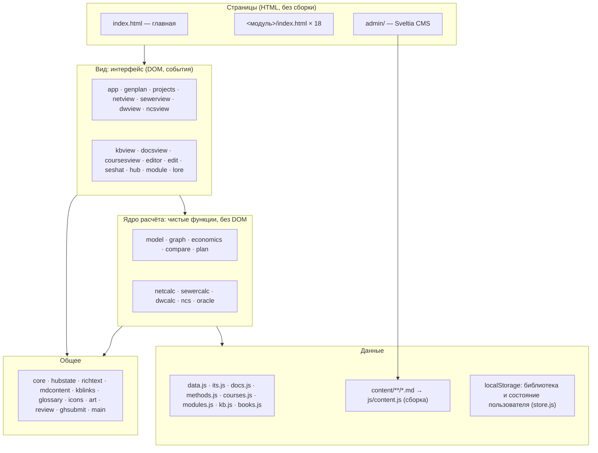
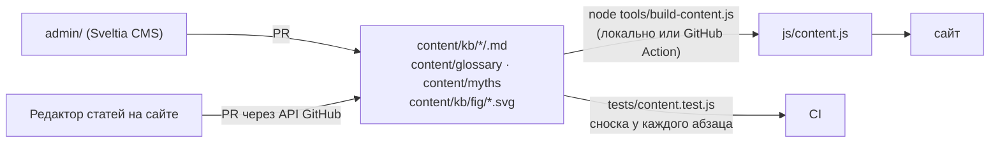
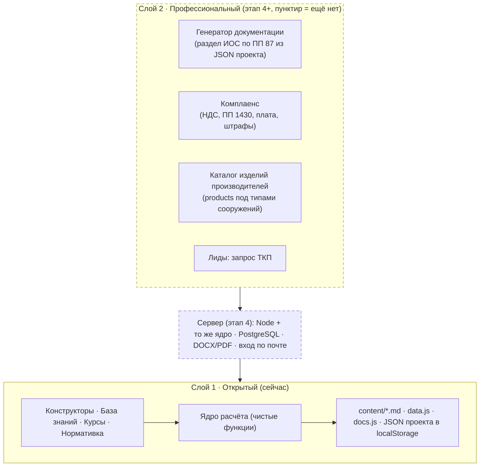

# Архитектура «Сешат»

Документ для онбординга технических специалистов и агентов. Читать первым, до любой правки кода.
Правила работы — в [AGENTS.md](AGENTS.md), этапы развития — в [ROADMAP.md](ROADMAP.md), принятые решения — в [docs/decisions/](docs/decisions/).

Актуален для версии **0.53.1** (14.11.2026). Тест `tests/architecture.test.js` проверяет, что каждый файл `js/*.js` описан здесь.

## 1. Что это

«Сешат» — инженерная платформа водного хозяйства (ВКХ): база знаний + расчётные конструкторы + курсы на одном движке.
Два слоя: **открытый** (всё, что есть сейчас: статично, бесплатно, CC BY-SA) и **профессиональный** (в плане: сервер, аккаунты, каталог изделий, генератор документации, комплаенс).

Четыре инварианта, которые архитектура обязана поддерживать:

1. Открытое ядро бесплатно, без регистрации, работает без сервера (даже с флешки).
2. Прозрачность расчёта: любое число раскрывается до формулы, пункта нормы и источника.
3. Нейтральность: ранжирование по объективным критериям, спонсорство помечено.
4. Кураторы и рецензенты работают без Git и без программирования.

## 2. Слои

Правило зависимостей: **вид → ядро → данные**, никогда наоборот. Ядро не знает о DOM и о `localStorage`; данные не содержат логики. Файл, который нарушает это правило, не проходит ревью.

### 2.1. Порядок подключения скриптов

Скрипты подключаются тегами `<script>` в порядке зависимостей; ES-модулей и сборщика нет (см. [ADR-001](docs/decisions/001-no-build.md)). Каждый файл кладёт один объект в `globalThis` с префиксом `Seshat*` (`SeshatModel`, `SeshatStore`…) и, если нужен в Node, экспортирует его же через `module.exports`. Новый файл добавляется в `index.html` **и** во все `*/index.html`, где он нужен, с `?v=<версия>`; тест `release.test.js` проверяет совпадение версий.

## 3. Карта файлов

### Данные (`js/`, только константы и справочники)

| Файл | Что хранит |
|---|---|
| `data.js` | показатели качества воды, 41 технология очистки (эффективности, капзатраты `cx`, энергия), примеры стоков, нормативы |
| `its.js` | сверка каталога с ИТС 10-2019: статус НДТ, страницы официального PDF |
| `docs.js` | нормативные документы: паспорт, структура со страницами, таблицы, «где искать» |
| `methods.js` | методики измерений показателей (ПНД Ф, ГОСТ) с источником подтверждения |
| `courses.js` | 40 программ курсов, 216 уроков (черновики) |
| `modules.js` | 18 модулей платформы: имя, путь, цвет-принадлежность, статус (`ready`, `stub`) |
| `kb.js` | учебники, журналы, сообщества по модулям; статьи сетей (`NETWORK`) |
| `books.js` | ссылки «где купить или прочитать» для книг |
| `myths.js`, `glossary.js` | тонкие обёртки над `content.js` |
| `content.js` | **генерируется** из `content/` командой `node tools/build-content.js`; руками не правится |

### Ядро расчёта (`js/`, чистые функции, тесты обязательны)

| Файл | Отвечает за |
|---|---|
| `model.js` | коэффициентная модель очистки: концентрации по ступеням, баланс N/P, прирост ила |
| `graph.js` | схема станции как граф: трубы, параллельные линии, доли потока |
| `economics.js` | капитальные и эксплуатационные затраты, себестоимость |
| `compare.js` | сравнение вариантов проекта, вывод о лучшем |
| `plan.js` | генплан: площади и раскладка сооружений |
| `netcalc.js` | кольцевая сеть водоснабжения: Лобачёв — Кросс, Шевелёв, напоры, пожар/авария |
| `sewercalc.js` | самотёчная водоотводящая сеть: диаметры и уклоны по СП 32, СП 399 прил. Б, Павловский; «логика расчёта» у каждого шага (норма / методика / допущение) |
| `dwcalc.js` | водоподготовка по СП 31: класс воды, схема, расчёт сооружений |
| `ncs.js` | НЦС 2026 сб. 14 и 19: интерполяция, региональные коэффициенты |
| `oracle.js` | ответы «Сешат» по правилам; точка подключения языковой модели `setProvider` |
| `store.js` | библиотека пользователя: схема данных, валидация, **миграции** (`VERSION`), адаптеры `local`/`memory` |

### Вид (`js/`, DOM; тестируется через ядро, не напрямую)

| Файл | Экран |
|---|---|
| `app.js`, `genplan.js`, `art.js`, `icons.js` | конструктор очистки сточных вод: экран, план, обозначения |
| `projects.js` | раздел «Проекты», навигация модуля |
| `netview.js` | конструктор сети водоснабжения |
| `sewerview.js` | конструктор водоотводящей сети: план, профиль, стоимость по НЦС сб. 14, вкладка «Логика расчёта» |
| `dwview.js` | конструктор водоподготовки |
| `ncsview.js` | калькуляторы НЦС, вкладка «Стоимость» |
| `kbview.js`, `kblinks.js`, `richtext.js` | база знаний: страницы статей, автоссылки, разметка (KaTeX, сноски, таблицы) |
| `docsview.js` | страницы нормативных документов |
| `coursesview.js` | раздел «Курсы» |
| `editor.js`, `edit.js`, `review.js`, `ghsubmit.js` | редактор статей, панель правки, статусы и кураторы, отправка PR через API GitHub |
| `seshat.js` | страница и мини-окно разговора с «Сешат» |
| `hub.js`, `hubstate.js`, `module.js`, `lore.js` | главная, состояние пользователя на главной, страница модуля, мифы |
| `core.js` | общие помощники, библиотека, уведомления, переходы между страницами |
| `mdcontent.js` | разбор и запись Markdown-статей; работает в браузере и в Node |
| `main.js` | запуск: открытие раздела из адреса |

### Контент (`content/`)

Одна статья — один файл с паспортом (front matter). Коллекции и их схемы — `COLLECTIONS` в `js/mdcontent.js`. Полные тексты норм в репозитории **не хранятся** (правило «нормы не копируем»): на сайт идут структура, номера пунктов и страниц, пересказ.

### Инфраструктура

| Что | Где |
|---|---|
| Хостинг | GitHub Pages из `main`; свой домен — в плане |
| CI | `.github/workflows/tests.yml` — тесты на каждый PR; `content.yml` — пересборка статей после слияния; `freshness.yml` — еженедельная проверка ссылок и дат сверки → задача «Проверка актуальности»; `tag.yml` — тег `vX.Y.Z` на каждую новую версию в `main` |
| Тесты | `npm test` (`node --test`), 19 файлов; `node tools/build-content.js --check` |
| Качество данных | `tools/check-links.js`, `tests/ncs.test.js` (1623 значения сверены со сборниками), `tests/content.test.js` |
| Метрики | `node tools/metrics.js` — числа для месячного отчёта |

## 4. Модули и их состояние

| Модуль | Папка | Конструктор | База знаний | Статус |
|---|---|---|---|---|
| Очистка сточных вод | `tlazolteotl/` | полный (граф, генплан, экономика, проекты) | 49 сооружений, 22 процесса, 18 показателей | **готов, этап 1: экспертная проверка** |
| Сети водоснабжения | `juturna/` | кольцевая сеть, НЦС | 7 статей | работает |
| Очистка природных вод | `anahita/` | схема по СП 31 | 13 статей | работает, часть чисел «≈» |
| Водоотводящие сети | `cloacina/` | самотёчная сеть: план, профиль, НЦС, логика расчёта | нормативка (СП 32, 399, 131, 22) | работает (0.53) |
| Гидрология, Водные ресурсы, Гидротехника, Водозаборы | `tlaloc/ hapi/ yu/ enki/` | эскиз | нормативка, программы курсов | заготовка |
| Основы ×3, смежные ×7 | `fundamentals/ basics/ humanities/ …` | — | гуманитарные: 9 мифов, 5 статей | заготовка |

Статус модуля меняется только через `js/modules.js` (`ready`, `stub`, `note`) и эту таблицу — одним коммитом.

## 5. Куда идём (целевая архитектура)

Что это требует от кода уже сейчас (см. ADR):

- **JSON проекта — контракт.** Схема станции, сеть, схема водоподготовки сохраняются с `VERSION` и миграциями (`store.js`). Этот же JSON позже хранится на сервере и кормит генератор документации. Ломать формат без миграции запрещено.
- **Нормы — данные.** `docs.js` переводится в `content/docs/<id>.md` с паспортом (статус, редакция, дата проверки, чем заменён). Комплаенс слоя 2 — запрос к тем же данным.
- **Изделие — отдельная сущность.** Под типом сооружения (`UNITS[].id`) появляется список `products` с паспортными характеристиками, которые входят в расчёт. Поле закладывается в схему данных до наполнения.
- **Ядро одно.** Всё, что считается в браузере, должно без изменений выполняться в Node (`module.exports` + тесты). Это условие переноса на сервер.

## 5а. Город и карта (ADR-008, ADR-009)

Замысел платформы: главный экран — карта города с реальной геометрией (улицы, застройка, рельеф); ученик проектирует водную инфраструктуру города и углубляется по четырём уровням детализации до конструкторов модулей и базы знаний. Город — проект проектов, связанный балансом воды и загрязнений; ядра соблюдают общий контракт `calc → { выход, стоимость, энергия, проверки, логика }`. Единый движок плана `js/map.js` заменит абстрактные планы конструкторов. Сценарии городов — контент (`content/scenarios/`). Подробности и ограничения — в ADR.

## 6. Где находится разработка

Текущий этап и критерии перехода — в [ROADMAP.md](ROADMAP.md). Выпущенные версии — в [CHANGELOG.md](CHANGELOG.md) и тегах `v*`. Открытые задачи — на доске GitHub Projects. Месячные отчёты — `docs/reports/`.
